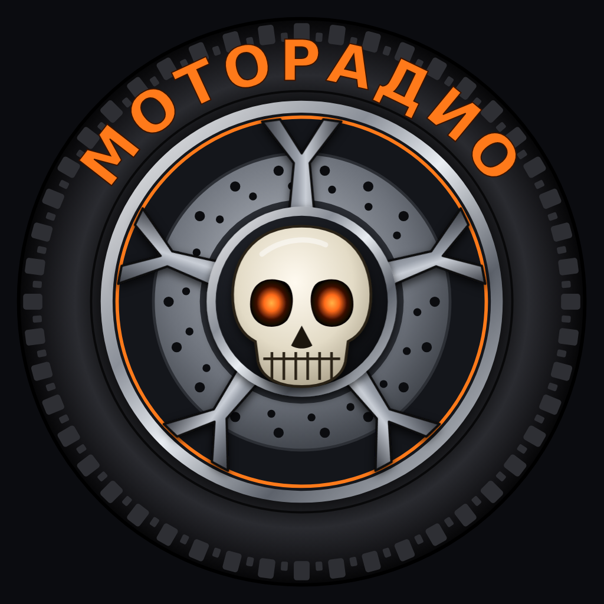

# MotoRadio для Android — приложение и виджет

Отдельное приложение на основе RockRadioNet со скином «Ночная трасса»: большой плеер с приборной панелью
(спидометр — громкость, тахометр — время трека). Скин зафиксирован, выбор скинов в настройках скрыт.
Если есть последняя станция, приложение сразу открывается на приборной панели.
Нажатие на саму панель (не на приборы и не на кнопки) переключает вид: «Ночная трасса» → «Люкс Турер» → «Спорт» → «Tour Enduro».
У своих файлов обложка альбома и фото исполнителя ищутся по исполнителю из тега файла (если тега нет — из имени «Исполнитель - Песня»), имя должно совпасть полностью; своя обложка файла важнее. Кнопка ▶ у папки — пуск и пауза, как «Пуск» плеера.
Если повернуть телефон боком, приборная панель открывается на весь экран, строка состояния и кнопки Android прячутся.
У своих файлов (раздел «Папки») тахометр показывает весь трек от 0 до 10, стрелкой его можно перематывать.
Встроено 142 станции (PodRadio-stations.txt Андрея от 05.11.2026). У каждой лого из его архива PodRadio-station-logo.zip: уменьшены до 256 точек и лежат в `app/src/main/assets/www/covers/s-NNN.webp` (NNN — номер строки в txt), открываются без интернета. Адреса потоков приложение поправляет само: CORS-прокси herokuapp обходит, просроченный token у потоков 101.ru убирает. В приложении лого из интернета скачиваются один раз, уменьшаются до 320 точек и хранятся в кэше (`Thumbs.kt`, адрес `/thumb?u=…`). Перед запуском потока `StreamResolve.kt` проходит переадресации и раскрывает плейлисты .pls/.m3u/.xspf/.asx; при повторных попытках плеер берёт адрес как есть, потом с другим протоколом. Экспорт сохраняется в файл «MotoRadio Station.txt».
Пакет `com.motoradio.player`, поэтому ставится рядом с обычным RockRadioNet и хранит свои станции и настройки отдельно.

Плюс виджет на рабочий стол в стиле нижнего проигрывателя.

## Что умеет

- **Виджет 4×2:** обложка трека (или логотип станции) с винилом, исполнитель, название песни,
  `[LIVE]` / `[ПАУЗА]`, кнопки: переподключить, предыдущая, пуск/пауза, следующая, случайная станция.
  Нажатие на обложку или текст открывает приложение. Размер виджета можно менять.
- **Фоновое воспроизведение** через системный плеер Android: играет при закрытом приложении
  и выключенном экране, уведомление с кнопками, управление с экрана блокировки.
- **Bluetooth-гарнитура и автомагнитола:** пуск/пауза, следующая и предыдущая станция.
- **Название трека** читается прямо из потока (ICY), картинка — из потока, если станция её передаёт, иначе обложка альбома или фото исполнителя (iTunes, Deezer; выбор в настройках) —
  без ограничений браузера, поэтому работает у большего числа станций, чем в HTML-версии.
- Пауза при отключении наушников, автопереподключение при обрыве (3 попытки).
- Импорт станций из txt, загрузка логотипов, фон, свой цвет, плитки — всё как в HTML-версии.
  Экспорт txt сохраняет файл через системный диалог.
- Кнопка «Назад» Android закрывает проигрыватель/меню/раздел, на главном экране сворачивает
  приложение (радио продолжает играть).

## Как получить APK без Android Studio (GitHub Actions)

Файл сборки — `.github/workflows/build.yml`. Он собирает APK при каждой загрузке файлов в репозиторий.

1. Создайте на github.com **новый пустой репозиторий** (можно приватный).
2. Нажмите **Add file → Upload files** и перетащите **содержимое** этой папки, включая скрытую папку `.github`.
   Если браузер её не берёт, загрузите остальное, затем нажмите **Add file → Create new file**,
   введите имя `.github/workflows/build.yml` и вставьте текст этого файла.
3. Нажмите **Commit changes**. На вкладке **Actions** запустится «Сборка MotoRadio» (около 5–8 минут).
   Запустить её заново можно кнопкой **Run workflow**.
4. Когда появится зелёная галочка, APK можно взять в двух местах:
   - во вкладке **Releases** справа на главной странице репозитория: `MotoRadio-1.0-N.apk`;
   - в самой сборке на вкладке Actions: архив **MotoRadio-APK** внизу страницы.
5. Скопируйте APK на телефон, откройте и разрешите установку из этого источника.

## Как собрать в Android Studio

1. Откройте папку проекта в Android Studio (Hedgehog или новее), дождитесь синхронизации Gradle.
   Если Studio предложит обновить Gradle/плагин — можно соглашаться.
2. **Build → Build App Bundle(s) / APK(s) → Build APK(s)**, или запустите на телефоне кнопкой ▶.

## Как добавить виджет

Долгое нажатие на пустом месте рабочего стола → **Виджеты** → **MotoRadio** →
перетащите «MotoRadio — плеер». Перед этим один раз откройте приложение,
чтобы виджет получил список станций.

## Где что лежит

| Файл | Назначение |
|---|---|
| `app/src/main/assets/www/index.html` | Интерфейс (HTML-версия плеера). Замените на новую версию — изменения попадут в приложение |
| `RadioService.kt` | Фоновое воспроизведение (Media3/ExoPlayer), уведомление, гарнитура, метаданные |
| `RadioWidget.kt` | Виджет на рабочий стол и его кнопки |
| `MainActivity.kt` | Окно приложения и связь страницы с плеером (`window.Android`) |
| `res/layout/widget_player.xml` | Внешний вид виджета |

## Примечания

- APK подписан отладочным ключом — подходит для установки на свои устройства.
  Для публикации в Google Play нужен собственный ключ подписи и targetSdk по текущим требованиям Play.
- Минимальная версия Android — 8.0.

## Сборка без Gradle (облако, 24.10.2026)

Звук играет системный `MediaPlayer` прямо со станции, название трека раз в 10 секунд читает `IcyMeta` (короткое отдельное соединение),
уведомление и экран блокировки — системные `MediaSession` и `Notification.MediaStyle`. Сторонних библиотек нет,
поэтому APK собирается скриптом `build-apk.sh` (aapt → javac → kotlinc → dalvik-exchange → zipalign → apksigner).
Подпись: `motoradio.keystore`, пароль `motoradio`, алиас `motoradio`. Ключ нужно сохранить: без него
новая версия не встанет поверх старой. Тахометр у радио рисует имитацию уровня (системный плеер уровень не отдаёт).
